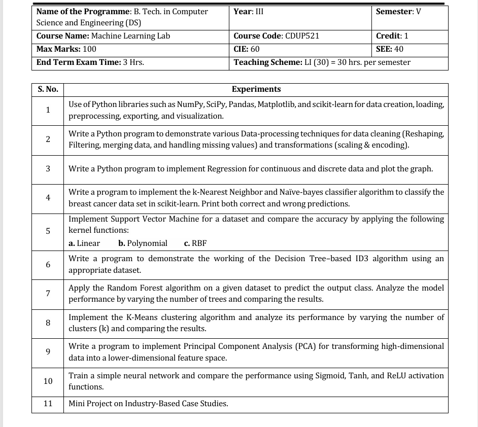
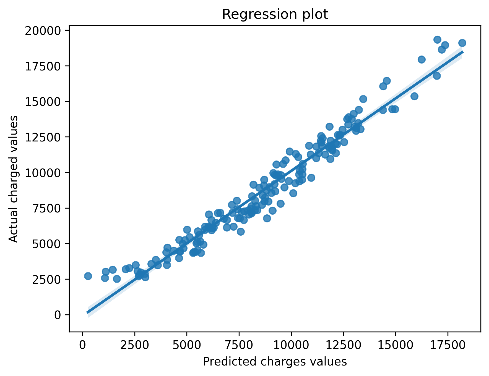

<div align="center">

# 🧠 Machine Learning Laboratory
### 📘 Course Code: `CDUP521` • Semester V • B. Tech. CSE (Data Science)

[](https://www.python.org/)
[](https://jupyter.org/)
[](https://scikit-learn.org/)
[](https://pandas.pydata.org/)
[](https://numpy.org/)
[](LICENSE)

<br/>

**Curriculum-aligned implementations of foundational & advanced Machine Learning algorithms, end-to-end data pipelines, exploratory analysis, and predictive modeling.**

---

[📖 Official Syllabus](#-course-syllabus--curriculum) •
[🧪 Experiment Index](#-laboratory-experiments-index) •
[📂 Repository Structure](#-repository-structure) •
[🚀 Getting Started](#-getting-started--setup) •
[📊 Visual Showcase](#-visualizations--plots) •
[👩‍💻 Author](#-author--acknowledgments)

---

</div>

## 📌 Course Overview

This repository contains the complete coursework, Jupyter Notebooks, datasets, and visualizations for the **Machine Learning Laboratory (CDUP521)**, prescribed for **Year III, Semester V** of the **B. Tech. in Computer Science and Engineering (Data Science)** program.

### 🎯 Key Learning Objectives
- **Data Engineering**: Data cleaning, imputation, transformation, encoding, and scaling with Pandas & NumPy.
- **Supervised Learning**: Linear & Polynomial Regression, $k$-Nearest Neighbors ($k$-NN), Naïve Bayes, Support Vector Machines (SVM), Decision Trees (ID3), and Random Forests.
- **Unsupervised Learning & Reduction**: $K$-Means Clustering and Principal Component Analysis (PCA).
- **Deep Learning Foundations**: Multi-layer Perceptron / Artificial Neural Networks (ANN) comparing Sigmoid, Tanh, and ReLU activations.
- **Model Evaluation**: In-depth evaluation using Confusion Matrices, Classification Reports, ROC/AUC, RMSE, and $R^2$ score.

---

## 📜 Course Syllabus & Curriculum

Here is the official syllabus scheme and prescribed experiment list for **CDUP521: Machine Learning Lab**:

<div align="center">



*Official Syllabus Scheme & List of Experiments (Machine Learning Lab - CDUP521)*

</div>

<br/>

### 📋 Course Scheme Summary

| Parameter | Specification Details |
| :--- | :--- |
| **Programme** | B. Tech. in Computer Science and Engineering (Data Science) |
| **Academic Year & Semester** | Year III &bull; Semester V |
| **Course Title** | Machine Learning Lab |
| **Course Code** | `CDUP521` |
| **Total Credits** | 1 Credit |
| **Teaching Scheme** | Practical: LI (30) = 30 Hours / Semester |
| **Evaluation Scheme** | Continuous Internal Evaluation (**CIE**): **60** \| Semester End Examination (**SEE**): **40** |
| **Maximum Marks** | **100 Marks** |
| **End Term Exam Time** | 3.0 Hours |

---

## 🧪 Laboratory Experiments Index

| Exp # | Prescribed Experiment Title | Key Concepts & Algorithms | Implemented In | Status |
| :---: | :--- | :--- | :---: | :---: |
| **01** | **Python ML Libraries & Data Workflow**<br>Use of NumPy, SciPy, Pandas, Matplotlib, and scikit-learn for data creation, loading, preprocessing, exporting, and visualization. | Array manipulation, DataFrame slicing, distribution plotting, summary statistics | [`exp1/`](./exp1/) | `Completed` |
| **02** | **Data Preprocessing & Cleaning Techniques**<br>Techniques for cleaning (Reshaping, Filtering, merging, handling missing values) and transformations (scaling & encoding). | Mean/Median imputation, MinMax/StandardScaler, Label & One-Hot Encoding | [`exp2/`](./exp2/) | `Completed` |
| **03** | **Regression Analysis (Continuous & Discrete Data)**<br>Implement Linear and Multiple Regression models, fit estimators, and plot regression trajectories. | Cost function minimization, OLS, Residual plotting, $R^2$, MSE, RMSE | [`exp3/`](./exp3/) | `Completed` |
| **04** | **k-NN & Naïve-Bayes Classification**<br>Classify the Wisconsin Breast Cancer dataset. Evaluate and print both correct and misclassified instances. | Euclidean distance metric, prior/posterior probabilities, Confusion Matrix | [`exp4/`](./exp4/) | `Completed` |
| **05** | **Support Vector Machine (SVM) Kernel Comparison**<br>Implement SVM and compare classification accuracy using: **(a)** Linear, **(b)** Polynomial, and **(c)** RBF kernels. | Maximum margin hyperplane, kernel trick, hyperparameter tuning ($C$, $\gamma$, degree) | [`exp5/`](./exp5/) | `Completed` |
| **06** | **Decision Tree Classifier (ID3 Algorithm)**<br>Demonstrate the ID3 algorithm using appropriate categorical datasets and plot the generated tree. | Information Gain, Shannon Entropy, recursive tree induction, `plot_tree` | [`exp6/`](./exp6/) | `Completed` |
| **07** | **Random Forest Classifier & Ensemble Tuning**<br>Predict class labels and evaluate model performance across varying numbers of decision trees (`n_estimators`). | Ensemble bagging, bootstrap aggregation, out-of-bag scoring, feature importance | [`exp7/`](./exp7/) | `Completed` |
| **08** | **K-Means Clustering & Centroid Optimization**<br>Unsupervised clustering on multi-dimensional data, analyzing performance by varying cluster counts ($k$). | WCSS (Within-Cluster Sum of Squares), Elbow Method, Silhouette Score | [`exp8/`](./exp8/) | `Completed` |
| **09** | **Principal Component Analysis (PCA)**<br>Transform high-dimensional feature spaces into orthogonal lower-dimensional representations. | Covariance matrix decomposition, Eigenvalues & Eigenvectors, explained variance | [`exp9/`](./exp9/) | `Completed` |
| **10** | **Artificial Neural Networks (Activation Functions)**<br>Train a feedforward neural network and benchmark performance across **Sigmoid**, **Tanh**, and **ReLU** activations. | Forward propagation, Backpropagation, gradient descent, non-linear activations | [`practise/ANN.ipynb`](./practise/ANN.ipynb) | `Completed` |
| **11** | **Mini Project on Industry Case Studies**<br>End-to-end data pipeline applied to industry datasets for predictive intelligence. | Exploratory Data Analysis, Feature Engineering, Model Selection & Tuning | [`practise/`](./practise/) | `In Progress` |

---

## 📂 Repository Structure

```text
ML_SEM5/
│
├── assets/
│   └── lab_syllabus.png           # Scanned curriculum & experiment scheme
│
├── exp1/                          # Experiment 1: Python Libraries for Data Science
│   ├── exp1.ipynb                 # NumPy & Pandas fundamentals
│   ├── exp1b.ipynb                # SciPy & statistical routines
│   ├── exp1_main.ipynb            # End-to-end data loading, EDA & export
│   ├── Airbnb_data.csv            # Airbnb market dataset
│   └── students.csv               # Student academic performance dataset
│
├── exp2/                          # Experiment 2: Data Preprocessing & Cleaning
│   ├── exp2.ipynb                 # Cleaning, missing values, encoding & scaling
│   ├── exp2_Linear_Regression.ipynb # Baseline regression on cleaned data
│   ├── Linear_Regression_Plot.png # Fitted vs Actual charges plot
│   └── new_insurance_data.csv     # Healthcare insurance charges dataset
│
├── exp3/                          # Experiment 3: Regression for Continuous & Discrete
│   ├── exp3.ipynb                 # Linear & Multiple Regression pipelines
│   ├── exp3_main.ipynb            # Discrete data regression & performance metrics
│   └── bank-additional-full.csv   # Bank marketing campaign dataset
│
├── exp4/                          # Experiment 4: k-NN & Naïve-Bayes Classifier
│   ├── exp4.ipynb                 # Breast Cancer diagnosis via k-NN
│   └── exp4_main.ipynb            # Naïve-Bayes classifier & misclassification study
│
├── exp5/                          # Experiment 5: Support Vector Machines (SVM)
│   └── exp5.ipynb                 # Kernel comparison: Linear vs Polynomial vs RBF
│
├── exp6/                          # Experiment 6: Decision Tree with ID3
│   ├── exp6.ipynb                 # ID3 information gain calculation
│   ├── exp6_main.ipynb            # Tree visualization & decision boundary
│   ├── decision.ipynb             # Tree pruning & evaluation
│   └── ServiceTest.csv            # Customer service classification dataset
│
├── exp7/                          # Experiment 7: Random Forest Classifier
│   └── exp7.ipynb                 # Tree count variation & hyperparameter tuning
│
├── exp8/                          # Experiment 8: K-Means Clustering
│   ├── exp8.ipynb                 # K-Means clustering & Elbow curve
│   └── exp8ii.ipynb               # Cluster validation metrics
│
├── exp9/                          # Experiment 9: Principal Component Analysis (PCA)
│   └── exp9.ipynb                 # Dimensionality reduction & 2D/3D projection
│
├── practise/                      # Sandbox & Supplementary Implementations
│   ├── ANN.ipynb                  # Exp 10: Neural Network (Sigmoid, Tanh, ReLU)
│   ├── exp1.ipynb - exp7.ipynb    # Additional practice problem sets
│   └── new_insurance_data.csv     # Insurance dataset for practice experiments
│
├── requirements.txt               # Python package dependencies
└── README.md                      # Comprehensive laboratory documentation
```

---

## 📊 Visualizations & Plots

Here are sample outputs generated during laboratory experimentation:

### 📈 Regression Analysis (Actual vs. Predicted Charges)
From [`exp2/exp2_Linear_Regression.ipynb`](./exp2/exp2_Linear_Regression.ipynb):

<div align="center">



*Fitted Linear Regression trajectory comparing predicted charges against actual healthcare insurance costs.*

</div>

---

## 🛠️ Tech Stack & Dependencies

| Category | Tools & Libraries |
| :--- | :--- |
| **Language** | Python 3.9+ |
| **Environment** | Jupyter Notebook, JupyterLab, VS Code |
| **Computation & Analysis** | `NumPy`, `Pandas`, `SciPy` |
| **Machine Learning** | `scikit-learn` |
| **Visualization** | `Matplotlib`, `Seaborn` |
| **Version Control** | Git & GitHub |

---

## 🚀 Getting Started & Setup

Follow these steps to run any notebook locally on your machine:

### 1. Clone the Repository
```bash
git clone https://github.com/KhushbooSuwalka/ML_SEM5.git
cd ML_SEM5
```

### 2. Create and Activate a Virtual Environment
- **On Windows (PowerShell):**
  ```powershell
  python -m venv venv
  .\venv\Scripts\Activate.ps1
  ```
- **On Linux / macOS:**
  ```bash
  python3 -m venv venv
  source venv/bin/activate
  ```

### 3. Install Required Dependencies
```bash
pip install -r requirements.txt
```

### 4. Launch Jupyter Notebook / Lab
```bash
jupyter lab
# or
jupyter notebook
```

Navigate to any experiment directory (e.g. `exp4/exp4_main.ipynb`) and execute the cells.

---

## 👩‍💻 Author & Acknowledgments

- **Student Author**: [Khushboo Suwalka](https://github.com/KhushbooSuwalka)
- **Degree**: B. Tech. in Computer Science & Engineering (Data Science)
- **Semester**: V Semester (Year III)
- **Course**: Machine Learning Lab (`CDUP521`)

---

<div align="center">

Made with ❤️ and ☕ for Machine Learning & Data Science.

⭐ **If you find this repository helpful, consider starring it on GitHub!**

</div>
